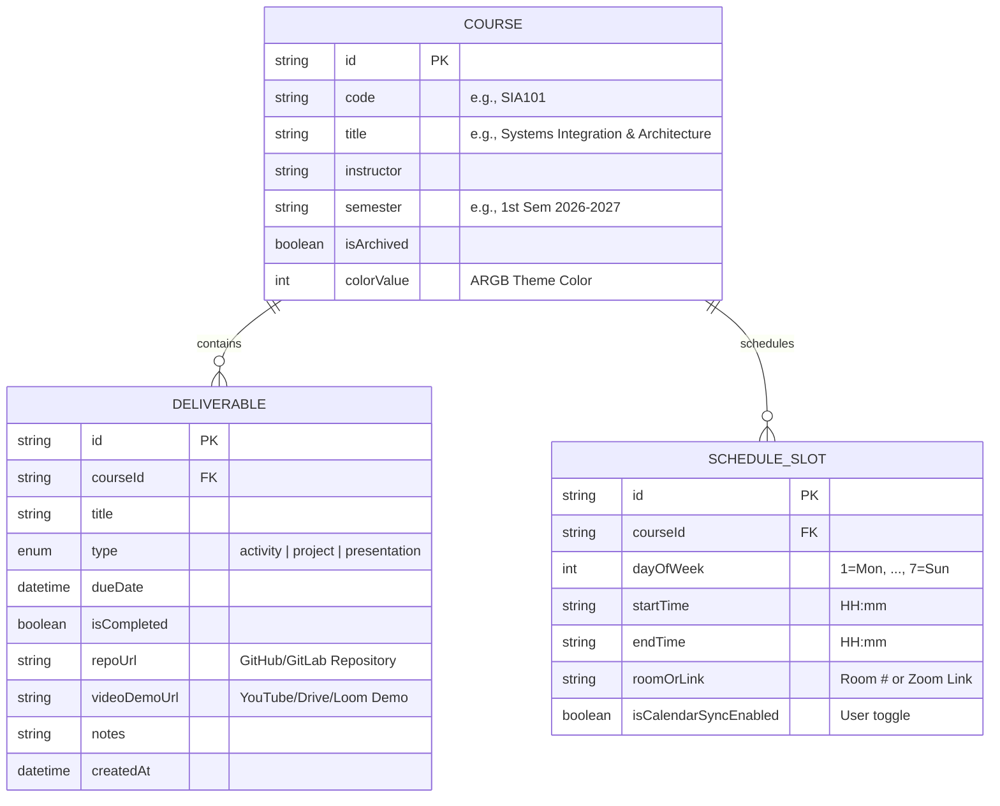

# System Architecture Specification
## Student Learning Management System (LMS) & Academic Portfolio

**Course:** System Integration and Architecture  
**Author:** Ben  
**Platform:** Flutter (Cross-platform: iOS, Android, Web, macOS)  
**Last Updated:** October 26, 2026

---

## 1. System Vision & Rationale

Traditional Learning Management Systems (Canvas, Blackboard, Moodle) are designed from an institutional perspective—prioritizing grading workflows, administrative oversight, and professor-to-student content broadcasting.

This project implements an **alternate, student-centric LMS** designed to serve as:
1. An **Academic Portfolio & Deliverable Archive** where students maintain ownership of their activities, presentations, and code projects (including GitHub repository links and video demonstrations).
2. A **Smart Timetable & Calendar Engine** where students have autonomous control over how their schedule populates their daily agenda.
3. A **Cross-Device Synced Workspace** retaining data integrity across mobile and desktop environments.
4. An **AI-Augmented Assistant Platform** designed to offer contextual study advice and workload realignment.

---

## 2. Architectural Design & Structure

The system is structured according to **Layered Architecture** principles, enforcing strict separation of concerns:

```
┌─────────────────────────────────────────────────────────────┐
│                      PRESENTATION LAYER                     │
│  - Widgets, Screens, UI Controllers, Material 3 Theme       │
│  - Features: Courses, Deliverables, Schedule, Navigation    │
└──────────────────────────────┬──────────────────────────────┘
                               │ (calls)
                               ▼
┌─────────────────────────────────────────────────────────────┐
│                         DOMAIN LAYER                        │
│  - Pure Dart Entities: Course, Deliverable, ScheduleSlot    │
│  - Business Rules & Invariants (Validation, Day Mapping)    │
└──────────────────────────────┬──────────────────────────────┘
                               │ (serialized via)
                               ▼
┌─────────────────────────────────────────────────────────────┐
│                          DATA LAYER                         │
│  - Mock Data Stores, Data Transfer Objects (DTOs)           │
│  - Cloud Gateways: Firebase Auth, Firestore, Gemini Client   │
└─────────────────────────────────────────────────────────────┘
```

---

## 3. Domain Entity Relationship Diagram (ERD)



---

## 4. Key Architectural Patterns Implemented

### 4.1 Immutability by Design
All domain entities (`Course`, `Deliverable`, `ScheduleSlot`) utilize `final` fields and `const` constructors. Mutating state requires creating new instances via functional copy methods, preventing accidental side-effects and optimizing Flutter's widget reconciliation algorithm.

### 4.2 Decoupled Data Mapping (Serialization)
Every entity provides bidirectional mapping:
* `toMap()`: Serializes Dart objects into generic `Map<String, dynamic>` structures compatible with JSON, SQLite, and Firestore.
* `factory fromMap()`: Deserializes key-value stores back into strongly typed domain objects with null-safety fallbacks.

### 4.3 User-First Calendar Synchronization Logic
The schedule subsystem separates the raw timetable data from the active calendar display:
$$\text{AgendaSlots} = \{ s \in \text{ScheduleSlots} \mid s.\text{dayOfWeek} = \text{selectedDay} \land s.\text{isCalendarSyncEnabled} = \text{true} \}$$
This grants students complete autonomy over their daily view without destroying their master timetable configuration.

---

## 5. System Integration Points (Roadmap)

### Integration 1: Google Identity Provider (OAuth 2.0)
* **Target Phase:** Phase 3
* **Protocol:** OpenID Connect / OAuth 2.0 via Google Identity Services and Firebase Authentication.
* **Architecture:** Decentralized token exchange returning a cryptographically signed JSON Web Token (JWT), caching session state in local secure storage.

### Integration 2: Cloud Data Persistence (Firebase Firestore)
* **Target Phase:** Phase 3 & 4
* **Protocol:** HTTPS / WebSocket real-time reactive streams.
* **Architecture:** Multi-device synchronization with offline-first persistence cache. Security rules will restrict read/write operations to authenticated user IDs (`request.auth.uid == resource.data.userId`).

### Integration 3: Artificial Intelligence Assistant (Google Gemini API)
* **Target Phase:** Phase 5
* **Protocol:** RESTful HTTPS / gRPC.
* **Architecture:** Context injection where the student's upcoming deadlines, active deliverables, and schedule constraints are formatted into structured system prompts, returning actionable schedule realignment recommendations.
