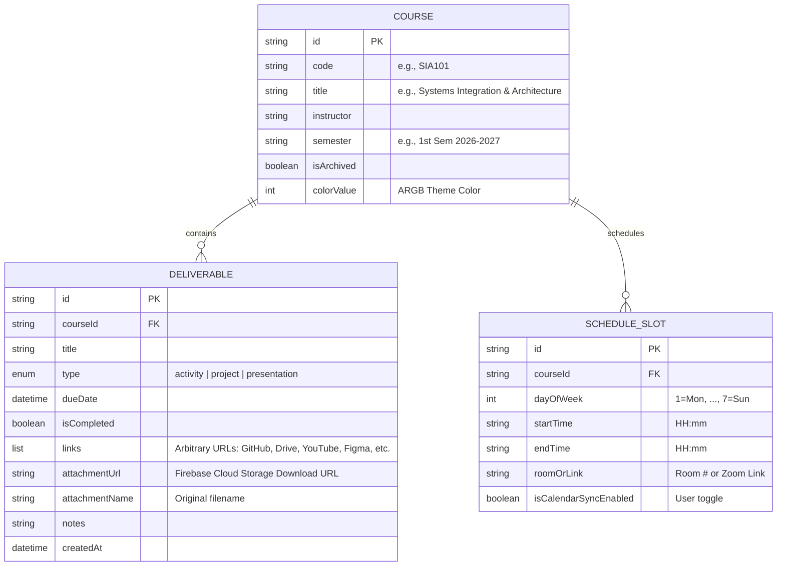

# System Architecture Specification: Syllo
## Student Learning Management System (LMS) & Academic Portfolio

**Course:** System Integration and Architecture  
**Author:** Ben  
**Platform:** Flutter (Cross-platform: iOS, Android, Web, macOS)  
**Live Application URL:** https://syllo-lms.web.app  
**Last Updated:** October 30, 2026

---

## 1. System Vision & Rationale

Traditional Learning Management Systems (Canvas, Blackboard, Moodle) are designed from an institutional perspective—prioritizing grading workflows, administrative oversight, and professor-to-student content broadcasting.

**Syllo** is an alternate, student-centric academic workspace and portfolio designed to serve as:
1. An **Academic Portfolio & Deliverable Archive** where students maintain ownership of their activities, presentations, and code projects (including GitHub repository links and video demonstrations).
2. A **Smart Timetable & Calendar Engine** where students have autonomous control over how their schedule populates their daily agenda.
3. A **Cross-Device Synced Workspace** retaining data integrity across mobile and desktop environments.
4. An **AI-Augmented Assistant Platform** designed to offer contextual study advice and workload realignment.

---

## 2. Architectural Design & Structure

The system is structured according to **Layered Architecture** principles, enforcing strict separation of concerns:

```
┌─────────────────────────────────────────────────────────────┐
│                      PRESENTATION LAYER                     │
│  - Widgets, Screens, UI Controllers, Material 3 Theme       │
│  - Features: Courses, Deliverables, Schedule, Navigation    │
└──────────────────────────────┬──────────────────────────────┘
                               │ (calls)
                               ▼
┌─────────────────────────────────────────────────────────────┐
│                         DOMAIN LAYER                        │
│  - Pure Dart Entities: Course, Deliverable, ScheduleSlot    │
│  - Business Rules & Invariants (Validation, Day Mapping)    │
└──────────────────────────────┬──────────────────────────────┘
                               │ (serialized via)
                               ▼
┌─────────────────────────────────────────────────────────────┐
│                          DATA LAYER                         │
│  - Mock Data Stores, Data Transfer Objects (DTOs)           │
│  - Cloud Gateways: Firebase Auth, Firestore, Gemini Client   │
└─────────────────────────────────────────────────────────────┘
```

---

## 3. Domain Entity Relationship Diagram (ERD)



---

## 4. Key Architectural Patterns Implemented

### 4.1 Immutability by Design
All domain entities (`Course`, `Deliverable`, `ScheduleSlot`) utilize `final` fields and `const` constructors. Mutating state requires creating new instances via functional copy methods, preventing accidental side-effects and optimizing Flutter's widget reconciliation algorithm.

### 4.2 Decoupled Data Mapping (Serialization)
Every entity provides bidirectional mapping:
* `toMap()`: Serializes Dart objects into generic `Map<String, dynamic>` structures compatible with JSON, SQLite, and Firestore.
* `factory fromMap()`: Deserializes key-value stores back into strongly typed domain objects with null-safety fallbacks.

### 4.3 User-First Calendar Synchronization & Lifecycle Filtering
The schedule subsystem separates the raw timetable data from the active calendar display, taking into account course lifecycle states:
$$\text{AgendaSlots} = \{ s \in \text{ScheduleSlots} \mid \exists c \in \text{Courses} : (c.\text{id} = s.\text{courseId} \land \neg c.\text{isArchived}) \land s.\text{dayOfWeek} = \text{selectedDay} \land s.\text{isCalendarSyncEnabled} = \text{true} \}$$

1. **Course Archival**: Moving a course to "Past Courses" automatically suspends its schedule slots from populating the active calendar agenda without losing their configuration. In Timetable Settings, archived schedules are badged and separated under `ARCHIVED COURSE SCHEDULES`. Restoring a course to active status instantly restores its schedules to the calendar.
2. **Cascading Referential Integrity**: Deleting a course performs an atomic cascade deleting all child schedule slots and deliverables from Firestore and local storage, preventing orphan entries or broken blank cards from lingering on the calendar.

### 4.4 Cloud Storage & Extensible Multi-Link Submissions
Rather than enforcing rigid, single-purpose URL boxes (e.g. only GitHub or YouTube), the coursework subsystem empowers students with complete submission flexibility:
1. **Dynamic Link Collection**: Students can attach an arbitrary number of optional links (`List<String> links`) representing any web resource (Figma prototypes, Notion documentation, Google Drive folders, personal portfolios, code repos, or demo videos).
2. **Binary Blob Cloud Storage**: Direct photo and file uploads (diagrams, photos of physical lab work, PDFs) are decoupled from Firestore and stored in Firebase Cloud Storage (`FirebaseStorageService`) under `users/{userId}/courses/{courseId}/attachments/`, persisting only the HTTPS download URL in Firestore. An abstract `StorageService` contract ensures mock-ability for testing and offline environments.

### 4.5 Emil Kowalski Alabaster Frost & Biophilic Motion Architecture
The UI incorporates Emil Kowalski's micro-interaction and tactile design principles, paired with a scientifically grounded **Biophilic Focus & Endurance** color palette (Kaplan Attention Restoration Theory & UBC learning performance studies):
1. **Biophilic Focus & Endurance Palette (`AppTheme`)**:
   - **Deep Oceanic Teal (`#0F766E` / `#0D9488`)**: Activates the parasympathetic nervous system to promote calm, analytical focus and deep work during coding and reading.
   - **Sage Emerald (`#10B981`)**: Centered on the visible spectrum to minimize optical fatigue and replenish depleted cognitive reserves.
   - **Warm Honey Ochre (`#F59E0B`)**: Provides selective alertness for upcoming deadlines and priority deliverables without inducing cortisol or panic.
   - **Alabaster Mint (`#F6F9F8`)**: Soft, anti-glare canvas eliminating harsh screen contrast.
2. **Vibrant Frosted Gradient App Bar (`FrostedAppBar`)**: Luminous top headers across screens (`CoursesScreen`, `ScheduleScreen`, `AiAssistantScreen`, `CourseDetailsScreen`) utilizing `BackdropFilter` (blur 20 sigma), dual-stop gradient washes (Deep Oceanic Teal `#0F766E` to Luminous Focus Teal `#0D9488` and Sage Emerald `#10B981`), and a specular highlight bottom border (`#0D9488.withOpacity(0.18)`), establishing visual depth while floating above content. In `CourseDetailsScreen`, the gradient wash dynamically adapts to the course's theme color.
3. **Tactile Spring Physics (`BouncyTap`)**: Scale transitions with overshoot springs (`CurvedAnimation` with easeOutCubic) providing immediate tactile feedback on all cards, buttons, and chips.
4. **Ambient Mesh (`AmbientMeshBackground`)**: Subtle floating translucent biophilic teal, sage, and mint blobs creating background depth without jarring brightness or distraction.
5. **Frosted Glass Containers (`GlassContainer`)**: Translucent cards featuring dual specular borders and subtle drop shadows.
6. **Satisfying Checkbox (`SatisfyingCheckbox`)**: Multi-phase micro-animated spring-pop checkbox with scale bump and haptic-style visual pulse for deliverable task completion.

---

## 5. System Integration Points (Roadmap)

### Integration 1: Google Identity Provider (OAuth 2.0)
* **Status:** Implemented (Phase 3)
* **Protocol:** OpenID Connect / OAuth 2.0 via Google Identity Services and Firebase Authentication.
* **Architecture:** Decentralized token exchange returning a cryptographically signed JSON Web Token (JWT), caching session state in local secure storage. Integrated via `FirebaseAuthService` implementing the `AuthService` abstraction.

### Integration 2: Cloud Data Persistence (Firebase Firestore)
* **Status:** Implemented (Phase 4)
* **Protocol:** HTTPS / WebSocket real-time reactive streams via `FirestoreLmsRepository`.
* **Architecture:** Multi-device synchronization with offline-first persistence cache. Partitioned by `users/{userId}/...` subcollections ensuring complete data isolation. Adheres to the Repository Pattern allowing transparent switching between cloud Firestore and in-memory test stores.

### Integration 3: Artificial Intelligence Assistant (Google Gemini API)
* **Status:** Implemented (Phase 5)
* **Protocol:** RESTful HTTPS via Google Gemini 1.5 Flash (`generativelanguage.googleapis.com`) with intelligent contextual mock fallback.
* **Architecture:** Grounded in a real-time **Academic Context Engine** (`AcademicContextEngine`) that injects the student's enrolled courses, today's lecture schedule, and pending deliverables into structured system prompts.
* **User Control & Optionality:** Opt-in feature managed in the "Student Profile & Cloud Sync" preferences. When enabled, a 3rd navigation tab ("AI Coach") dynamically appears in the bottom glass navigation bar with Emil Kowalski tactile physics. Provides quick action chips (*"What should I focus on today?"*, *"Break down my upcoming project"*, *"Create a study timetable"*, *"Review my course workload"*).

